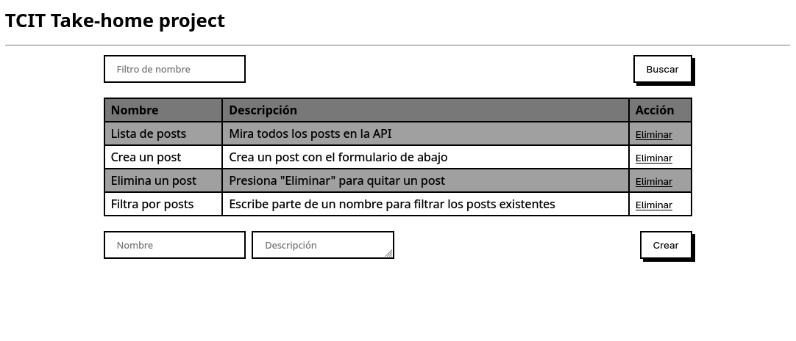

# TCIT.cl Take-home Project Front-end

Simple front-end that shows the user a list of Posts, allowing them to create, delete and search for them. Using React, Redux and Axios. Created for TCIT.cl. Consumes the API from its [back-end sister project](https://github.com/honiemun/tcitcl-server).

## Usage

Create an `.env` file based on the `.env.example`.

To run this site in dev mode with Vite, install dependencies with `npm i` and run `npm run dev`. Requires Node v22 or higher.

You will need the [tcitcl-server API](https://github.com/honiemun/tcitcl-server) to use this project.